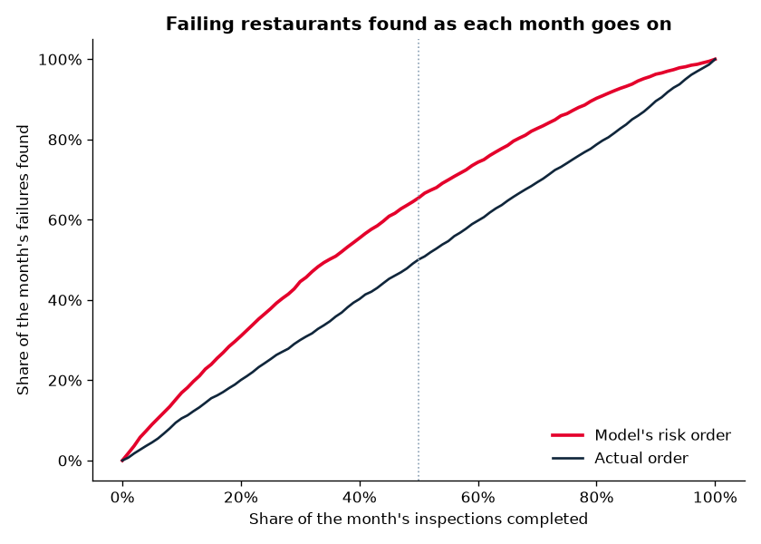

# Restaurant Inspection Risk

Predicting which Chicago restaurants are most likely to fail their next health inspection, so inspectors can visit the riskiest ones first.

App link: https://restaurant-inspection-risk.streamlit.app/ 

If the app is asleep, click "Yes, get this app back up!" and give it about a minute.


## The business question
Health departments can't inspect every restaurant at once. If they could rank restaurants by risk, they would catch dangerous kitchens sooner with the same number of inspectors. Chicago's public health department has built a version of this model; this project recreates the idea and extends it with text analysis of inspector notes.

## Data
- **Chicago Food Inspections** (Chicago Data Portal, dataset `4ijn-s7e5`): every food inspection in the city, with the result, the restaurant's license number and location, and the inspector's comments on each violation.
- **Chicago 311 Service Requests** (Chicago Data Portal, dataset `v6vf-nfxy`): rodent, sanitation, and restaurant complaints, counted near each restaurant in the days before each inspection.
- **Daily weather** (Open-Meteo historical weather API): temperature and precipitation around each inspection date.

## How to run
```bash
python3 -m venv .venv
source .venv/bin/activate
pip install -r requirements.txt

python src/download_data.py   # downloads the raw data (a few minutes)
python src/clean.py           # cleans it -> data/processed/inspections_clean.csv
python src/eda.py             # charts -> reports/figures/, summary -> reports/eda_summary.md
python src/features.py        # model features -> data/processed/features.csv
python src/train.py           # baseline + models -> reports/model_results.md

# Step 3: outside data
python src/download_external.py                  # 311 complaints + weather
python src/external_features.py                  # -> data/processed/features_plus.csv
python src/train.py --features features_plus.csv # -> reports/model_results_plus.md

# Step 4: business impact simulation
python src/simulation.py      # -> reports/simulation_results.md

# Step 5: interactive app
streamlit run app.py

# Step 6: live predictions (runs by itself every Monday on GitHub Actions)
pip install -r requirements-live.txt
python src/live.py            # -> live/ and reports/live_track_record.md
pytest                        # tests for the live pipeline and the LLM evaluation

# Step 7: LLM evaluation (needs OmniRoute running locally with a Gemini key)
export OMNIROUTE_API_KEY=$(cat ~/.omniroute_key)
python src/llm_eval.py        # -> reports/llm_eval.md
```

## Project structure
```
restaurant-inspection-risk/
├── data/
│   ├── raw/
│   ├── processed/
│   └── reference/
│       └── violation_groups.csv
├── .github/workflows/
│   └── live.yml
├── live/
│   ├── snapshots/
│   └── outcomes.csv
├── models/
├── notebooks/
├── reports/
│   ├── figures/
│   ├── eda_summary.md
│   ├── model_results.md
│   ├── simulation_results.md
│   ├── live_track_record.md
│   ├── llm_eval.md
│   └── llm_eval/
├── src/
│   ├── download_data.py
│   ├── clean.py
│   ├── eda.py
│   ├── features.py
│   ├── train.py
│   ├── download_external.py
│   ├── external_features.py
│   ├── simulation.py
│   ├── live.py
│   └── llm_eval.py
├── tests/
│   ├── test_live.py
│   └── test_llm_eval.py
├── app.py
├── requirements.txt
└── requirements-live.txt
```

## Cleaning decisions
- Kept only facility types containing "restaurant."
- Kept Pass, Pass w/ Conditions, and Fail. Dropped "Out of Business," "No Entry," and similar results, since no inspection actually happened.
- Grouped dozens of inspection type spellings into routine (canvass), complaint, re-inspection, license, and other.
- Parsed the violations text into a count, the list of violation numbers, and the inspector comments (saved for NLP later).
- Chicago adopted a new food code on July 1, 2018, which renumbered violations. The `new_food_code` column marks inspections after that date.
- To avoid data leakage, the "previous result" columns use only a restaurant's earlier inspections. The current inspection's violations are never used to predict its own result.

## Findings
See [reports/eda_summary.md](reports/eda_summary.md).

## Results
Tested on 15,363 routine inspections from January 2024 to October 2026, using a model trained only on earlier years.

Business impact ([full report](reports/simulation_results.md)): each month keeps its real inspection dates, and the model only changes which restaurant gets visited first.
- Failing restaurants would have been found 3.2 days sooner on average, for a total of 11,381 fewer days that failing kitchens stayed open before an inspector arrived.
- By the middle of each month, inspectors would have found 65.5% of that month's failures, compared to 50.1% in the actual order.



Model vs. baseline ([full report](reports/model_results.md)): with the same number of flags as the simple rule "failed its last routine inspection," the model finds 1,155 failing restaurants vs. 934 (+221, about 24% more).

A restaurant's average number of past violations was the strongest signal, more than whether it passed or failed. Restaurants that keep barely passing with many violations are a warning sign the pass/fail result hides.

Nearby 311 rodent and sanitation complaints and weather barely changed results ([report](reports/model_results_plus.md)), so a restaurant's own track record carries most of the signal. Logistic regression performed about as well as gradient boosting.

## Live track record
The results above come from past inspections the model never trained on. Step 6 goes one step further and tests the model on inspections that have not happened yet.

Every Monday a GitHub Action runs `src/live.py`, which:
1. downloads the newest inspections from the Chicago Data Portal,
2. checks every new routine inspection against the risk score saved **before** that inspection happened, and
3. saves a new risk score for every active restaurant to `live/snapshots/`.

The model is frozen, and each snapshot is committed to this repo the day it is made, so the git history shows every prediction came before its result. Running totals are in [reports/live_track_record.md](reports/live_track_record.md).

Rules the pipeline follows:
- A snapshot only uses inspections dated before the day it was made.
- An inspection is only compared to a snapshot from an earlier day, and it is scored once.
- Live features are built by the same `build_features` code used for training, and a test checks the two give the same score.
- The live folder only accepts snapshots dated today. Replays of past dates go to a separate folder and are labeled as replays.

## Can an LLM read inspector notes?
The model's text features come from keyword lists (step 2). Step 7 tests whether an LLM reads inspector notes better than those keywords, and better than a classic trained model.

Every violation in the data comes with an official code, which makes a free answer key: each method sees only the inspector's note and has to pick which of 7 categories it belongs to (pests, temperature, hand hygiene, food protection, cleaning, facilities, management & paperwork). Nothing is labeled by hand.

- Test set: 280 notes from 2025 on, 40 per category, saved in [`reports/llm_eval/test_notes.csv`](reports/llm_eval/test_notes.csv) so every method is scored on the same notes.
- Keyword rules: the risk model's own word lists.
- Trained model: TF-IDF + logistic regression on about 290,000 notes from before 2025, with any note identical to a test note removed.
- LLM: Gemini, zero-shot (category names and official titles only, no examples), through a local [OmniRoute](https://omniroute.online) gateway on Google's free tier. Its answers are saved, so the report can be rebuilt without calling it again.

Results and the full write-up: [reports/llm_eval.md](reports/llm_eval.md).
