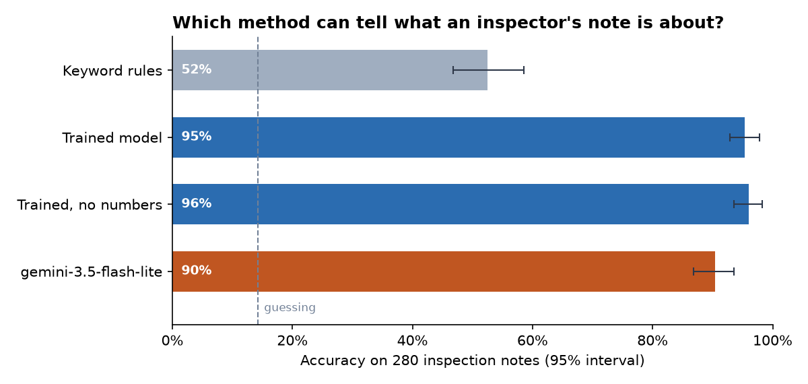

# Can an LLM classify inspection notes?

*Generated by `src/llm_eval.py`. Re-run it to refresh.*

Each violation in Chicago's data has an official code and the inspector's free-text note. The
codes are grouped into 7 categories ([`data/reference/violation_groups.csv`](../data/reference/violation_groups.csv)),
and every method sees only the note and has to pick the category. The official code is the answer
key, so no hand labeling is needed.

- **Test set:** 280 notes from Jan 2025 to Sep 2026,
  40 per category, no duplicates ([`test_notes.csv`](llm_eval/test_notes.csv)).
  With equal counts per category, guessing would score 14.3%.
- **Trained model:** 291,007 notes from before January 2025. Notes identical to a test note
  were removed so the model cannot simply memorize copy-pasted text.
- **LLM:** zero-shot. It gets the category names and the official violation titles in each one,
  but no labeled examples. Notes are sent 10 at a time with temperature 0.
- **Left out:** 2.2% of notes, under rare or administrative codes (for example
  "previous violation corrected").

## Results

| Method | Accuracy (95% CI) | Macro F1 |
|---|---|---|
| Keyword rules (the risk model's word lists) | **52.5%** (46.8% to 58.6%) | 0.482 |
| Trained model (TF-IDF + logistic regression) | **95.4%** (92.9% to 97.9%) | 0.953 |
| Trained model, numbers removed from notes | **96.1%** (93.6% to 98.2%) | 0.960 |
| LLM, zero-shot (gemini/gemini-3.5-flash-lite) | **90.4%** (86.8% to 93.6%) | 0.903 |

**The trained model wins.** LLM, zero-shot (gemini/gemini-3.5-flash-lite) got 90.4% with no training examples, 5.0 points below the trained model (95.4%). Compared note by note on the same 280 notes, the difference is -5.0 points (95% interval -8.6 to -1.8). The interval is entirely below zero, so the gap is real. Inspectors file similar problems under specific codes by habit, and a model trained on 291,007 of their notes learns those habits; the LLM only sees the category names and official titles. Both are far ahead of the keyword rules (52.5%), which only matched anything in 60.0% of notes.

**Do ordinance numbers give the answer away?** Notes often cite the city code broken
(e.g. "7-38-005"). With every digit removed, the trained model scores 96.1%
(vs. 95.4% with them), so its accuracy comes from the words themselves, not the numbers.

## F1 by category

| Category | Keyword rules | Trained model | Trained, no numbers | gemini-3.5-flash-lite |
|---|---|---|---|---|
| cleaning | 0.05 | 0.88 | 0.89 | 0.77 |
| facilities | 0.42 | 0.96 | 0.98 | 0.82 |
| food protection | 0.04 | 0.88 | 0.89 | 0.89 |
| hand hygiene | 0.77 | 0.97 | 0.99 | 0.94 |
| management & paperwork | 0.63 | 1.00 | 1.00 | 0.98 |
| pests | 0.67 | 0.99 | 0.99 | 0.96 |
| temperature | 0.80 | 0.99 | 0.99 | 0.96 |

## Limits

- The answer key is the inspector's choice of code. Some notes fit two categories (dirty floors vs.
  dirty equipment), so no method can reach 100%.
- 280 notes give intervals of about ±3 to ±6 points. Small differences between methods are noise.
- The LLM was tested on one prompt with no examples. Adding a few labeled examples to the prompt
  would likely help it.
- This tests classification only. Running the LLM on all 370,000 notes to feed the risk model
  was out of reach on a free tier.
